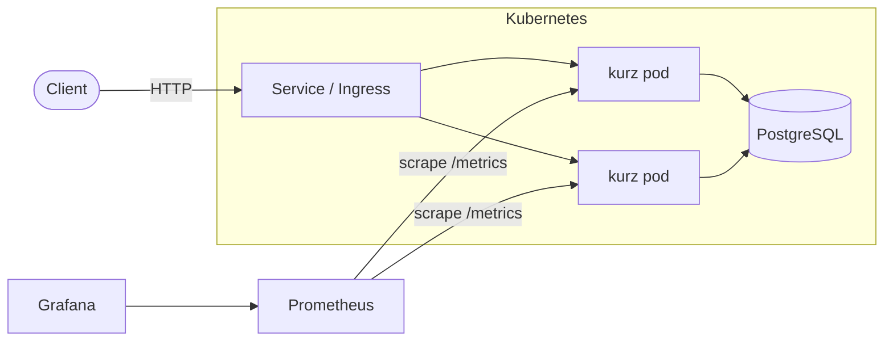
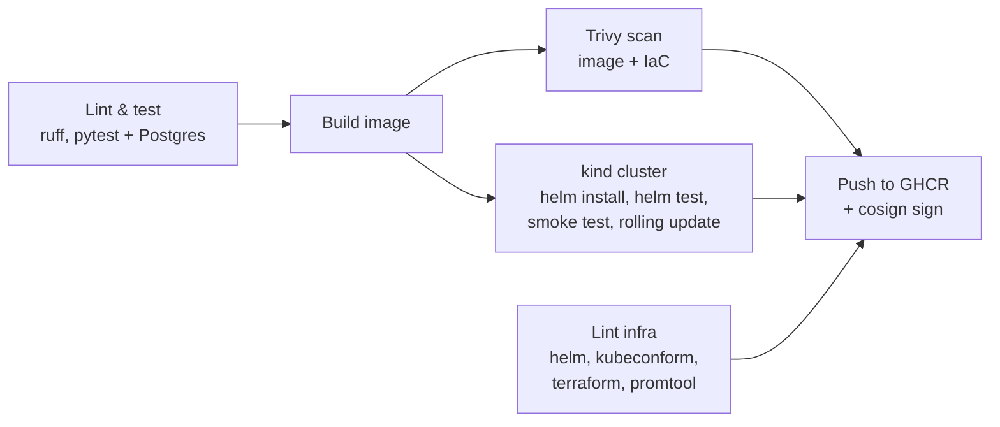

# kurz

[](https://github.com/TTAmin/kurz/actions/workflows/ci.yml)
[](LICENSE)

*kurz* (German for "short") is a small URL shortener. The app is deliberately simple;
the point of this repository is everything around it: how the code is built, tested,
scanned, shipped, deployed and observed.

| Area | What is here |
| --- | --- |
| Containers | Multi-stage Dockerfile, non-root user, health check, docker compose stack |
| CI/CD | GitHub Actions: lint, tests against a real Postgres, image build, security scans, deploy to a throwaway Kubernetes cluster, smoke and rolling-update tests, publish to GHCR, keyless image signing |
| Kubernetes | Helm chart with probes, resource limits, hardened security context, PDB, optional HPA, Ingress, ServiceMonitor |
| Infrastructure as Code | Terraform for AWS: EC2 with k3s, least-privilege security group, IMDSv2, encrypted disk, budget alert |
| Observability | Prometheus metrics, JSON logs, Grafana dashboard, alert rules |
| Supply chain | Trivy (image + IaC), Dependabot, pinned dependencies, Cosign signatures |

## Architecture



## Pipeline



Every pull request runs the full chain up to `e2e`; only `main` publishes. The image that is
tested in the kind cluster is byte-for-byte the image that gets pushed: it is built once and
passed between jobs as an artifact, never rebuilt.

## Quick start

### Docker compose (app, Postgres, Prometheus, Grafana)

```bash
docker compose up --build
```

- API and interactive docs: http://localhost:8000/docs
- Prometheus: http://localhost:9090 (alerts under *Alerts*)
- Grafana: http://localhost:3000 (dashboard *kurz* opens as the home page)

```bash
curl -X POST localhost:8000/api/links -H 'content-type: application/json' \
     -d '{"url": "https://github.com"}'
# {"code":"aZ3kQ9x","short_url":"http://localhost:8000/aZ3kQ9x", ...}

curl -i localhost:8000/aZ3kQ9x          # 307 -> https://github.com
curl localhost:8000/api/links/aZ3kQ9x    # click count
```

### Kubernetes on kind

Needs [kind](https://kind.sigs.k8s.io/), kubectl and Helm.

```bash
kind create cluster --name kurz
docker build -t kurz:dev .
kind load docker-image kurz:dev --name kurz
helm install kurz deploy/helm/kurz \
  --set image.repository=kurz,image.tag=dev,image.pullPolicy=Never --wait
helm test kurz
kubectl port-forward svc/kurz 8080:80
scripts/smoke-test.sh http://localhost:8080
```

Or use the published image instead of building: `helm install kurz deploy/helm/kurz --wait`.
Every published image is signed by the CI workflow on `main` (keyless, Sigstore). Check that
an image really came from there before running it:

```bash
cosign verify ghcr.io/ttamin/kurz:latest \
  --certificate-identity https://github.com/TTAmin/kurz/.github/workflows/ci.yml@refs/heads/main \
  --certificate-oidc-issuer https://token.actions.githubusercontent.com
```

### AWS (optional)

[`infra/terraform/aws`](infra/terraform/aws) creates one EC2 instance running k3s, so the same
Helm chart runs in a real cloud. A `t3.small` costs about USD 0.02 an hour; run
`terraform destroy` when you are done, and set `budget_alert_email` to get mailed before the
bill grows.

```bash
cd infra/terraform/aws
cp terraform.tfvars.example terraform.tfvars   # fill in your SSH key and IP
terraform init && terraform apply
# then follow the printed fetch_kubeconfig and ssh_tunnel commands and:
helm install kurz ../../../deploy/helm/kurz \
  --set ingress.enabled=true,ingress.className=traefik,baseUrl=http://<public_ip>
```

The Kubernetes API is not exposed to the internet: it is reached through an SSH tunnel, and
SSH itself only from the CIDR you configure.

## API

| Method | Path | |
| --- | --- | --- |
| `POST` | `/api/links` | Create a link: `{"url": "...", "code": "optional-custom"}` |
| `GET` | `/api/links/{code}` | Link details and click count |
| `GET` | `/{code}` | 307 redirect to the target |
| `GET` | `/healthz` | Liveness: the process runs (no database call) |
| `GET` | `/readyz` | Readiness: the database answers |
| `GET` | `/metrics` | Prometheus metrics |

Configuration is environment only (`KURZ_DATABASE_URL`, `KURZ_BASE_URL`, `KURZ_LOG_LEVEL`),
following the twelve-factor model.

## Design decisions

- **Liveness and readiness are different questions.** `/healthz` never touches the database:
  if Postgres goes down, restarting every app pod would not help and would only add load.
  `/readyz` does check it, so pods stop receiving traffic instead.
- **A database outage is a 503, not a 500.** A 500 says "bug in this code"; a lost database
  is an outage, and 503 with `Retry-After` tells clients and load balancers to come back later.
  One warning line replaces a traceback per request. Each connection attempt gives up after
  2 s: a database host that does not answer otherwise blocked a request for 21 s (measured
  under Docker Desktop; about two minutes on Linux).
- **Alerts ignore noise and are unit-tested.** The error ratio counts user traffic only (not
  health checks or scrapes) and needs at least 5 failures in 5 minutes; the latency alert needs
  20 redirects before a 95th percentile means anything. Found in a manual outage test, where a
  browser's two `favicon.ico` requests sent both alerts to pending. `monitoring/alerts.test.yml`
  replays that case and two real outages; CI runs it with `promtool test rules`.
- **Metrics are labelled by route template, not by path.** `route="/{code}"`, never
  `route="/aZ3kQ9x"`: one label value per short link would grow Prometheus' memory without
  bound. A test guards this.
- **Schema creation is safe with several replicas.** All pods start at once against a fresh
  database. The app waits for Postgres with exponential backoff and takes a Postgres advisory
  lock around `CREATE TABLE`, so two replicas never race. (A real project would use Alembic
  migrations; see roadmap.)
- **Click counting is one atomic `UPDATE ... RETURNING`**, so concurrent redirects never lose
  a count.
- **Hardened pods.** Non-root UID, read-only root filesystem, all capabilities dropped,
  seccomp `RuntimeDefault`, no service account token mounted.
- **Zero-downtime rollouts.** `maxUnavailable: 0`, a readiness gate and a PodDisruptionBudget
  cover new pods; a `preStop` delay covers old ones. Kubernetes sends SIGTERM and removes a pod
  from the Service at the same moment, and the endpoint change needs a moment to reach every
  node, so without the delay traffic still arrives at a pod that has stopped listening. CI
  proves it: a pod inside the cluster follows a link every 50 ms through the Service while
  `helm upgrade` replaces every pod, and a single failed request fails the build. Without the
  delay that test lost 6 and 10 of about 1,400 requests in two runs.
- **Scans gate on what can be fixed.** The pipeline fails on critical image vulnerabilities
  that have a fix, and on any HIGH or CRITICAL misconfiguration in the Dockerfile, the Helm
  chart or the Terraform code. Accepted exceptions live in [`.trivyignore`](.trivyignore),
  each with its reason. Image findings from HIGH up that have a fix are reported to GitHub
  code scanning; unfixed ones in the Debian base image appear there once Debian ships a fix.
- **No package manager in the runtime image.** pip is removed from the final stage: the app
  never needs it, an attacker cannot install tools with it, and the libraries pip vendors
  (urllib3, msgpack, pkg_resources) were the image's only fixable HIGH findings.
- **Every action is pinned by commit SHA**, not by tag, with the version as a comment:
  a tag can be re-pointed to other code, as happened to `trivy-action`'s tags in March 2026,
  and these actions run with access to the repository's secrets. Dependabot keeps the SHAs
  current.

## Project layout

```
app/                    FastAPI application
tests/                  pytest suite (SQLite locally, Postgres in CI)
deploy/helm/kurz/       Helm chart
infra/terraform/aws/    Terraform for an EC2 + k3s environment
monitoring/             Prometheus config, alert rules, Grafana dashboard
scripts/smoke-test.sh   end-to-end check against any running instance
.github/                CI pipeline and Dependabot
```

## Local development

```bash
python -m venv .venv
source .venv/bin/activate        # Windows: .venv\Scripts\activate
pip install -r requirements-dev.txt
pytest --cov
uvicorn app.main:create_app --factory --reload
```

Without `KURZ_DATABASE_URL` the app uses a local SQLite file.

## Roadmap

- Alembic migrations, run as a Kubernetes Job before each rollout
- GitOps deployment with Argo CD
- Rate limiting per client
- OpenTelemetry tracing

## License

MIT
